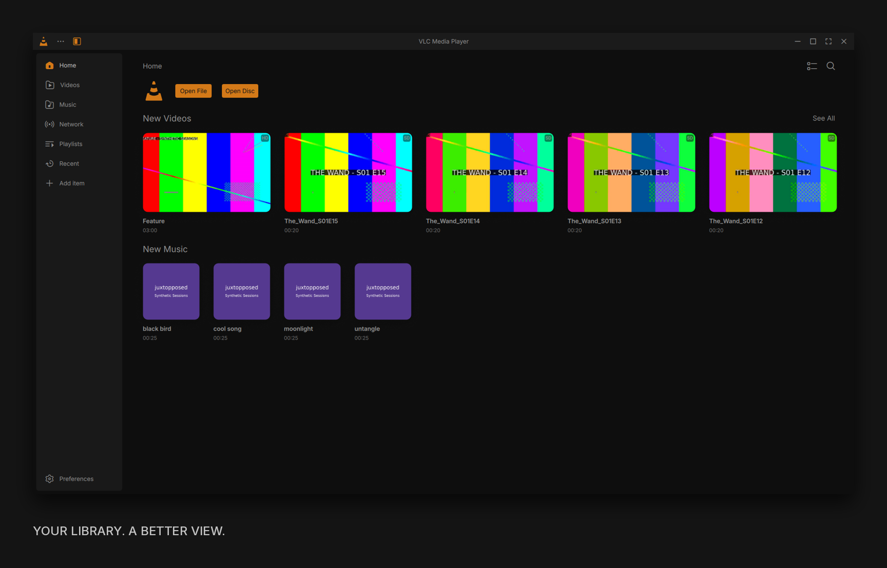
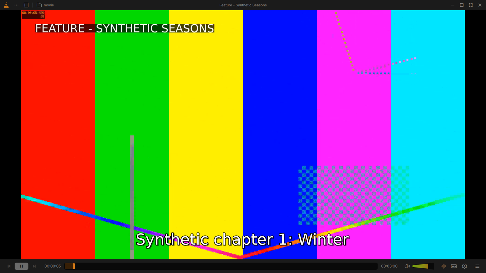
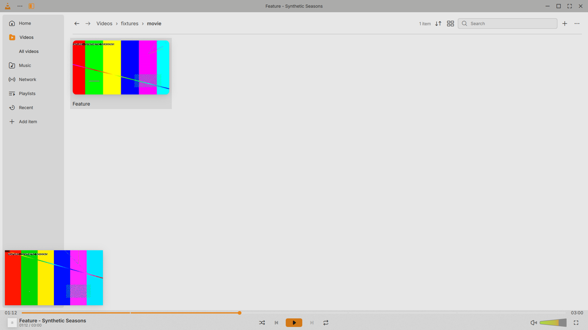
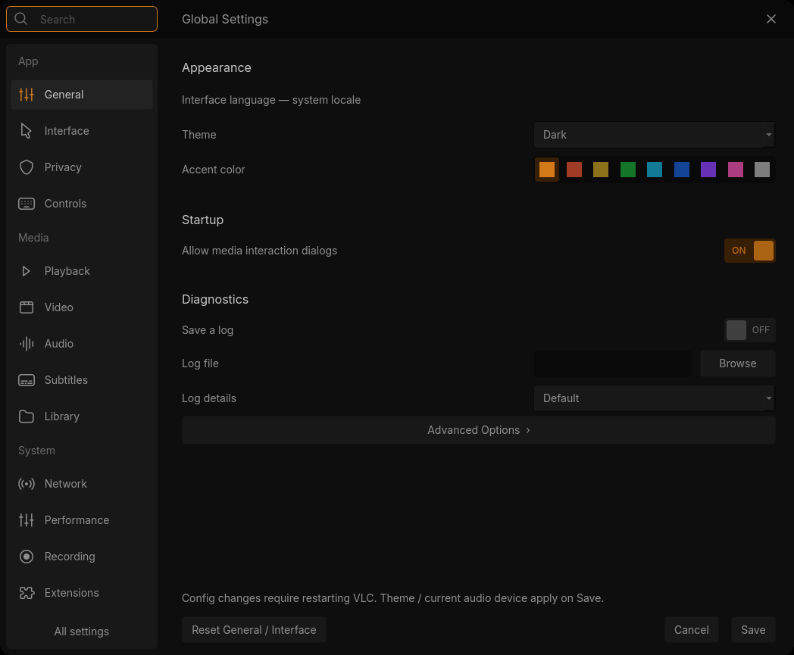
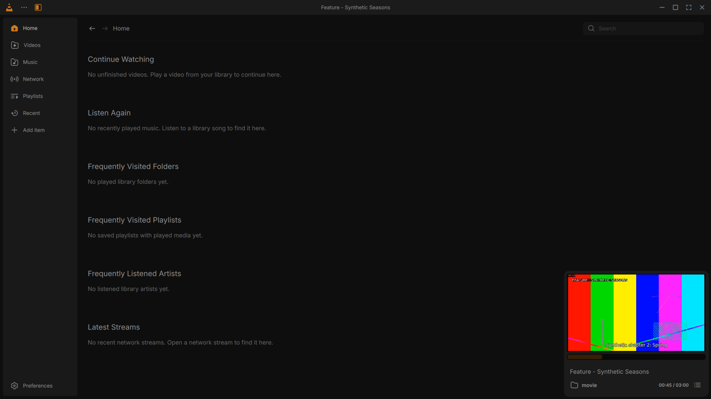

# VLC, reimagined.

**Juxtopposed's redesign. A real desktop player.**

Built on VLC 4. Made for macOS, Linux and Windows.

[v0.1](https://github.com/ShikherVerma/vlc-juxtopposed/releases/tag/v0.1) · [The design](https://www.figma.com/community/file/1691465999134370980/vlc-redesign) · [Build it](docs/BUILDING.md) · [Follow along](https://x.com/shikheronline/status/2110155866196631936)

## Your player. Less clutter.

A cleaner player. A library worth browsing. Settings you can actually find.

| Watch | Browse |
| :---: | :---: |
|  |  |
| **More screen. Less chrome.** | **Keep watching while you browse.** |
|  |  |
| **Your settings, organized.** | **One library. Your next watch.** |

## In v0.1

The first desktop preview brings the core redesign to all three platforms.

| Feature | macOS | Linux | Windows |
| :--- | :---: | :---: | :---: |
| Dark and light themes, accent colors | Built | Built | Built |
| Redesigned player and volume controls | Built | Built | Built |
| Hide UI and fullscreen controls | Built | Built | Built |
| Continue watching | Built | Built | Built |
| Main menu and right-click menu | Built | Built | Built |
| Queue, bookmarks and chapters | Built | Built | Built |
| Playback, audio and subtitle adjustments | Core | Core | Core |
| Home, video folders and search | Built | Built | Built |
| Music, playlists, network and recent files | Built | Built | Built |
| Grid, list, sorting and navigation | Built | Built | Built |
| Compact library and docked mini-player | Built | Built | Built |
| Five settings pages, 101 controls | Built | Built | Built |

*Built = implemented. Core = the main controls, with deeper tools still coming.*
[Full feature list](docs/FEATURES.md) · [Platform testing](docs/STATUS.md)

## The inspiration

**[Watch Juxtopposed's original video](https://www.youtube.com/watch?v=ERFeOgqk324)**

## Up next

**v0.2:** deeper audio/video tools, more settings pages, a redesigned shortcut editor.

**Beyond:** drag-and-drop layouts, profiles, smarter subtitles, seek previews, floating picture-in-picture and a sleep timer.

[See the roadmap](docs/ROADMAP.md)

## From a tweet to a player

> “Absolutely loved this. I'm coding this up. Already burned through $2380 Claude tokens and $895 Codex tokens. Will be on github soon. Forked over VLC v4 branch.”
>
> [Shikher Verma (@shikheronline), October 13, 2026](https://x.com/shikheronline/status/2110155866196631936)

Built by [Shikher Verma](https://github.com/ShikherVerma). Design by **[Juxtopposed](https://www.youtube.com/@juxtopposed)**. Powered by **[VideoLAN](https://www.videolan.org/) and the VLC contributors**.

Independent community project. [Source and credits](docs/CREDITS.md).
