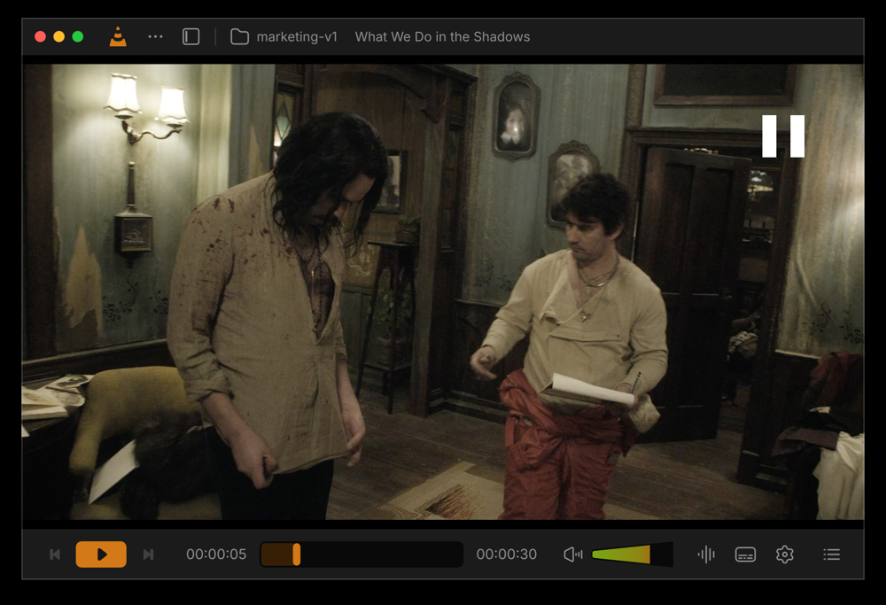
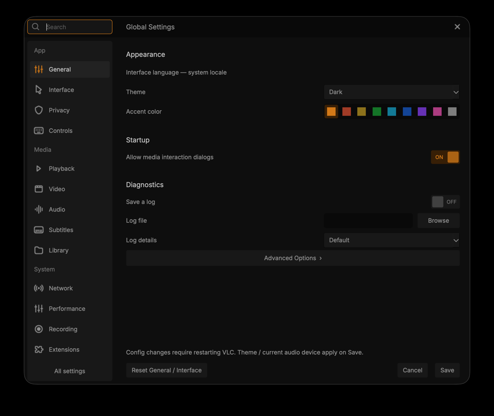

<div align="center">

# VLC, reimagined.

**Juxtopposed's redesign. Brought to life.**

A cleaner player. A proper media library. Your favorite VLC, with a fresh face.

**macOS · Linux · Windows**

[v1](https://github.com/ShikherVerma/vlc-juxtopposed/releases/tag/v1) · [Install](#install) · [Original design](https://www.figma.com/community/file/1691465999134370980/vlc-redesign)

</div>



## Install

**From source:** [macOS](docs/BUILDING.md#macos-apple-silicon) · [Linux](docs/BUILDING.md#linux) · [Windows](docs/BUILDING.md#windows-x64)

```sh
git clone https://github.com/ShikherVerma/vlc-juxtopposed.git
cd vlc-juxtopposed
git checkout v1
```

Follow your platform's build steps above. Packaged downloads are being prepared.

## Settings that make sense.

Five redesigned pages. 101 controls. Search, change, save.



## In v1

| Feature | macOS | Linux | Windows |
| :--- | :---: | :---: | :---: |
| Dark/light themes and accent colors | Built | Built | Built |
| Redesigned player, volume and fullscreen controls | Built | Built | Built |
| Continue watching | Built | Built | Built |
| Main menu and right-click menu | Built | Built | Built |
| Queue, bookmarks and chapters | Built | Built | Built |
| Playback, audio and subtitle adjustments | Core | Core | Core |
| Home, video folders, music and search | Built | Built | Built |
| Playlists, network streams and recent files | Built | Built | Built |
| Grid, list, sorting and navigation | Built | Built | Built |
| Compact library and docked mini-player | Built | Built | Built |
| Five settings pages, 101 controls | Built | Built | Built |

*Built = implemented. Core = main controls, with deeper tools coming next.*
[Full feature list](docs/FEATURES.md) · [Platform testing](docs/STATUS.md)

## The video that started it.

[](https://www.youtube.com/watch?v=ERFeOgqk324)

**[Watch Juxtopposed's original redesign](https://www.youtube.com/watch?v=ERFeOgqk324)**

## Next up

**Next:** deeper audio/video tools, more settings pages and a redesigned shortcut editor.

**Further ahead:** drag-and-drop layouts, profiles, smarter subtitles, seek previews, floating PiP and a sleep timer.

[Roadmap](docs/ROADMAP.md)

> “Absolutely loved this. I'm coding this up. Already burned through $2380 Claude tokens and $895 Codex tokens. Will be on github soon. Forked over VLC v4 branch.”
>
> [Shikher Verma (@shikheronline), October 13, 2026](https://x.com/shikheronline/status/2110155866196631936)

Built by **[Shikher Verma](https://github.com/ShikherVerma)**. Design by **[Juxtopposed](https://www.youtube.com/@juxtopposed)**. Powered by **VideoLAN and the VLC contributors**.

<sub>Independent community project. [Credits](docs/CREDITS.md).</sub>
